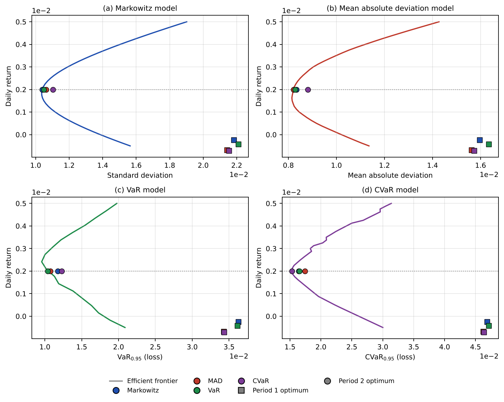

# Portfolio Optimization Across Market Regimes

This project builds minimum-risk portfolios of four Budapest Stock Exchange stocks with four optimization models (Markowitz, mean absolute deviation, Value-at-Risk, and Conditional Value-at-Risk), solves them on two consecutive half-year periods, and checks how the first-period portfolios perform after the market reverses.

The short answer is that the estimation period mattered far more than the model. All four models gave similar portfolios within each period, but the portfolios changed almost completely between periods, and the first-period optima fell well inside the second-period efficient frontiers.



## Data

Daily closing prices from the Budapest Stock Exchange (BÉT historical data), May 20, 2025 to May 20, 2026, for four stocks from different sectors:

| Ticker | Company | Sector |
|---|---|---|
| OTP | OTP Bank | Banking |
| MTELEKOM | Magyar Telekom | Telecommunications |
| RICHTER | Gedeon Richter | Pharmaceuticals |
| WABERERS | Waberer's International | Logistics |

Prices are converted to daily log returns (248 observations per stock), stored in `log_returns.csv`, and split at November 20, 2025:

- Period 1: May 21 – November 19, 2025 (127 trading days)
- Period 2: November 20, 2025 – May 20, 2026 (121 trading days)

The two periods behave very differently. Annualized returns:

| | OTP | MTELEKOM | RICHTER | WABERERS |
|---|---:|---:|---:|---:|
| Period 1 | +28.7% | −6.8% | −15.2% | +37.2% |
| Period 2 | +50.8% | +88.3% | +48.1% | −37.7% |

## Models

All models use the same target daily return $\bar r = 0.002$, a 95% confidence level for VaR and CVaR, and allow short positions. Let $x$ be the portfolio weights, $r_t$ the vector of returns on day $t$, $\mu$ the mean return vector, $C$ the covariance matrix, and $T$ the number of days. Every model shares the constraints

$$\mu^\top x = \bar r, \qquad \mathbf{1}^\top x = 1.$$

Markowitz (quadratic program):

$$\min_x \; x^\top C x$$

Mean absolute deviation (linear program):

$$\min_{x,d,f} \; \sum_{t=1}^T (d_t + f_t) \quad \text{s.t.} \quad r_t^\top x + d_t - f_t = \bar r, \quad d_t, f_t \ge 0$$

Value-at-Risk (mixed-integer linear program). Binary variables $b_t$ mark the days allowed to fall below the VaR level, at most $(1-\alpha)T$ of them:

$$\max_{x,V,b} \; V \quad \text{s.t.} \quad r_t^\top x \ge V - b_t, \quad \sum_{t=1}^T b_t \le (1-\alpha)T, \quad b_t \in \{0,1\}$$

Daily returns are small, so a big-M constant of 1 is enough to switch a constraint off.

Conditional Value-at-Risk (linear program, Rockafellar–Uryasev formulation):

$$\min_{x,Z,U} \; Z + \frac{1}{(1-\alpha)T} \sum_{t=1}^T U_t \quad \text{s.t.} \quad U_t \ge -r_t^\top x - Z, \quad U_t \ge 0$$

Efficient frontiers are traced on period 2 by re-solving each model over a grid of target returns.

## Results

Optimal weights at the 0.002 daily target:

| Model | Period | OTP | MTELEKOM | RICHTER | WABERERS |
|---|---|---:|---:|---:|---:|
| Markowitz | 1 | 0.871 | −0.217 | −0.212 | 0.558 |
| MAD | 1 | 0.716 | −0.206 | −0.196 | 0.686 |
| VaR | 1 | 0.858 | −0.285 | −0.152 | 0.580 |
| CVaR | 1 | 0.721 | −0.229 | −0.177 | 0.686 |
| Markowitz | 2 | −0.010 | 0.413 | 0.430 | 0.167 |
| MAD | 2 | 0.115 | 0.365 | 0.372 | 0.148 |
| VaR | 2 | 0.039 | 0.447 | 0.330 | 0.184 |
| CVaR | 2 | −0.152 | 0.572 | 0.344 | 0.236 |

Main observations:

- Within each period, the four models agree on direction and differ mainly in size. In period 1 every model is long OTP and Waberer's and short Magyar Telekom and Richter, which is what the period's returns favored.
- Between periods, the portfolios almost flip. Magyar Telekom and Richter go from short positions to the largest long positions, and OTP drops from the dominant holding to roughly zero.
- Each model is optimal on its own risk measure, as expected: Markowitz has the lowest standard deviation, MAD the lowest mean absolute deviation, and so on.
- The VaR frontier is less regular than the Markowitz and MAD frontiers. As the target return changes, a different combination of binary variables can become optimal and the solution jumps. This reflects that VaR, unlike CVaR, is not a coherent risk measure and is less stable on a discrete sample. The VaR frontier also uses a coarser grid of target returns, because the mixed-integer program is slower to solve.
- The CVaR frontier shows small kinks at high target returns. These are likely an artifact of plotting: the CVaR on the chart is computed from an interpolated sample percentile, which does not match the tail definition used in the optimization exactly.
- In the figure, the period 1 optima (squares) sit well below and to the right of every period 2 frontier. Portfolios optimized on one regime were clearly inefficient in the next, and the gap between periods is much larger than the gap between models.

The takeaway is that when markets change regime, refining the risk model helps far less than deciding which data to estimate from and how often to rebalance.

## Repository structure

| File | Purpose |
|---|---|
| `gen.py` | Loads the data, solves all models for both periods, traces the frontiers, and writes `results.json`, `R1.npy`, and `R2.npy` |
| `figs.py` | Draws the four-panel frontier figure (`frontiers.png`) from `results.json` |
| `lp.py` | Exports the period 1 models as LP files (`MAD1.lp`, `VaR1.lp`, `CVaR1.lp`, `markowitz1.lp`) for an independent cross-check in GLPK/GUSEK |
| `log_returns.csv` | Daily log returns used in the analysis |
| `frontiers.png` | The figure above |

## How to run

Requirements: Python 3.10+, with

```bash
pip install numpy pandas openpyxl cvxpy highspy matplotlib
```

The models are solved with CVXPY, using Clarabel for the quadratic program and HiGHS for the linear and mixed-integer programs.

```bash
python gen.py    # solve models, write results.json
python figs.py   # draw frontiers.png
python lp.py     # optional: export LP files for GLPK/GUSEK
```

`gen.py` works from the repository alone: it reads the daily returns in `log_returns.csv`. If the raw BÉT price export (`historikus_2025_05_20__2026_05_20_.xlsx`) is placed in the same folder, the script rebuilds the returns from prices instead.

## Limitations

- Four stocks and one year of data: the results illustrate the methods rather than support general conclusions.
- Short positions are unrestricted, and transaction costs are ignored.
- Each period has only about 125 observations, so the 5% tail used by VaR and CVaR rests on about six days.
